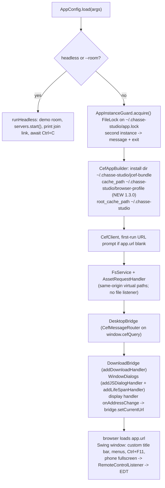
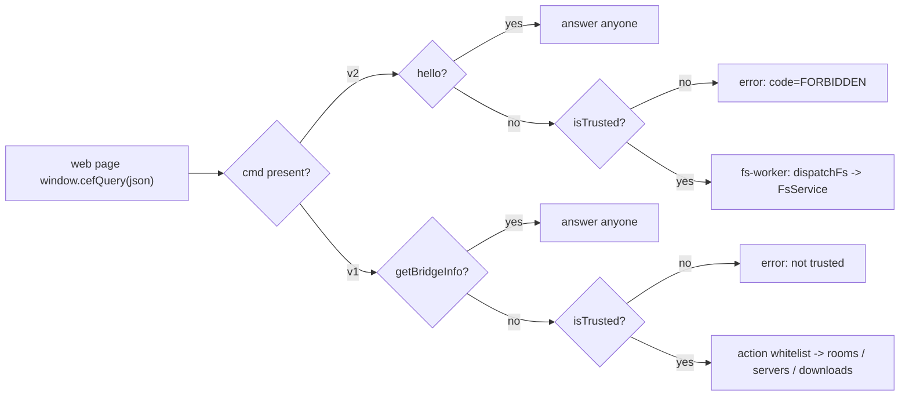
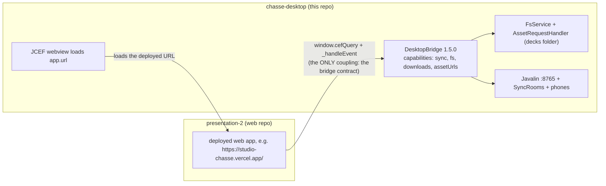

# Architecture

All sources live in `src/main/java/com/chasse/desktop/`. One process, three
transports: the web page over `window.cefQuery` (bridge), the phones over
WebSocket, and desktop assets through same-origin JCEF interception.

## Modules

| File | Role |
|---|---|
| `Main.java` | Entry point, Swing window, custom title bar/menus/fullscreen, JCEF bootstrap, shutdown (3s halt guard) |
| `AppConfig.java` | Config layering (bundled → `~/.chasse-studio/app.properties` → CLI), `downloads.dir` persistence |
| `AppInstanceGuard.java` | Single-instance `FileLock` on `~/.chasse-studio/app.lock` |
| `DesktopBridge.java` | The JCEF bridge: v1 actions + v2 cmds, origin trust, event push (protocol version 1.3.0) |
| `FsService.java` | Owns the decks folder: confinement, atomic writes, limits, `config.json` |
| `AssetRequestHandler.java` | Same-origin JCEF asset interception; confined worker-streamed file reads |
| `ServerManager.java` | Javalin lifecycle on 0.0.0.0:8765, LAN address scan/watch, log ring (200), port probe |
| `SyncRooms.java` | In-process room state machine (one room per deck), canonical state JSON |
| `PhoneWsHandler.java` | Phone WebSocket sessions: token-checked join, nav, heartbeat, broadcasts |
| `RemotePage.java` | Serves the bundled self-contained `/remote` HTML (title from `remote.page-title`) |
| `LanAddresses.java` | RFC1918 address scan, preferred prefix, virtual-adapter de-prioritization, 5s watcher |
| `DownloadBridge.java` | `CefDownloadHandler`: native Save-as, progress events, "Open folder" |
| `WindowDialogs.java` | `CefJSDialogHandler` (alert/confirm/prompt/beforeunload → Swing), `onBeforePopup` → system browser |

## Startup (GUI mode)

Notes verified in `Main.java`:

- **JCEF settings**: `windowless_rendering_enabled = --osr`,
  `remote_debugging_port = --devtools`, extra `--cef-arg` switches,
  install dir `~/.chasse-studio/jcef-bundle`.
- **Persistent profile (1.3.0 — the root-cause fix for the save bug)**:
  `cache_path = ~/.chasse-studio/browser-profile` and
  `root_cache_path = ~/.chasse-studio` are now set. Without `cache_path` CEF
  runs with an **in-memory profile** (incognito-like), so the web app's
  IndexedDB/localStorage fallback was wiped on every restart — the desktop
  app "could not save" (worklog `audit-phase-0` root-cause finding;
  `CefSettings.cache_path` defaults to null in jcef-17e805a/Chromium 152).
- **Instance guard**: acquired only in GUI mode (headless skips it). Second
  instance → "already running" dialog + exit 0.
- **Shutdown**: `servers.stop()` → `browser.close(true)` → `cefApp.dispose()`,
  with a daemon 3s `halt(0)` guard so the app exits even if CEF hangs.
- The asset handler is attached directly to `CefClient`; its reads are
  independent of the phone remote server's start/stop state.

## THE BRIDGE CONTRACT

Mirror of the web repo's contract doc — **both sides must match byte-for-byte**.
Transport: `window.cefQuery(json)` over `CefMessageRouter`. Every query is
answered exactly once (errors also travel via the success callback).

### v1 — sync actions

Request `{id, action, payload}` → response `{"id":..,"ok":true,"data":{..}}` or
`{"id":..,"ok":false,"error":".."}`.

| Action | Payload | Result |
|---|---|---|
| `getBridgeInfo` | — | `{trusted, version, platform, appUrl}` — the only v1 action answered on untrusted pages |
| `getServerStatus` | — | `{status, port, addresses[{address,iface,display,virtual}], selectedAddress, error}` |
| `getServerLog` | — | `{lines:[{ts,level,text}...]}` — seeds the panel; live lines arrive as events |
| `startServer` / `stopServer` / `restartServer` | — | async on the bridge worker; `{ok:true}` immediately |
| `selectAddress` | `{address}` | `{selectedAddress}` (only accepts addresses in the current list) |
| `joinRoom` | `{deckId, role?, slides, slideId?, step?}` | `{state, token}`; pushes `sync-token` when the room was just created; fresh rooms honor the `slideId`/`step` resume hint |
| `setSlide` | `{deckId, slideId, step}` | `{ok:true}` or `unknown room` |
| `nav` | `{deckId, dir?}` (`next`/`prev`) | `{ok:true}` |
| `reportSteps` | `{deckId, slideId, steps}` | clamped 1..50 |
| `syncDeck` | `{deckId, slides}` | re-sync the slide order after edits |
| `setNotes` | `{deckId, slideId, note}` | cap 8000 chars, U+2028/U+2029 stripped |
| `setUi` | `{deckId, qr?, overview?}` | relayed to the room's phones |
| `ping` | — | `{t}` |
| `openDownloadFolder` *(NEW 1.3.0)* | — | `{ok}` — reveals the folder of the last completed download; **takes no path** |

### v2 — hello + fs commands

Request `{cmd, ...params}` → the raw contract shape, or `{code, message}` on
failure.

| cmd | Params | Result |
|---|---|---|
| `hello` | — | `{app:"chasse-desktop", version:"1.3.0", capabilities:["sync","fs","downloads"]}` — answered on untrusted pages (capability discovery, same info level as `getBridgeInfo`) |
| `fs.getRoot` | — | `{configured, path, valid}` |
| `fs.chooseRoot` *(NEW: params honored)* | `{title?, startPath?, hint?}` | native folder chooser; `title` on the dialog, `startPath` when it exists, `hint` in the grant confirmation; returns the `getRoot` shape |
| `fs.listDecks` | — | `[{id,title,folder,slides,modified}]` |
| `fs.readText` | `{deck, path}` | `{text}` |
| `fs.writeText` | `{deck, path, text}` | `{ok:true}` — atomic, refuses symlinks |
| `fs.createDeck` | `{deck, files:{path→text}}` | `{ok:true, id}` — ≤500 files, `deck.json` required and written **LAST** |
| `fs.deleteDeck` | `{deck}` | `{ok:true}` — success only once the folder is verified gone |
| `fs.duplicateDeck` | `{deck, copyId, title?}` | `{ok:true, id}` — copy + patched `deck.json` (id/title/modified), deck.json last |
| `fs.listFiles` | `{deck, dir?}` | `[{name,directory,size,modified}]` — one level |
| `fs.delete` | `{deck, path}` | `{ok:true}` — file or folder, verified gone |
| `assetUrls` hello capability | — | Enables `/__chasse_files__/<deck>/<path>` interception |
| `fs.beginAssetUpload` / `fs.writeAssetChunk` / `fs.finishAssetUpload` | upload path + bounded chunks | streamed temp file + atomic rename |

**Error codes** (v2 failures, HTTP layer uses the same codes):
`FOLDER_NOT_SET`, `FOLDER_MISSING`, `NO_OS_PERMISSION`, `NOT_FOUND`,
`TOO_LARGE`, `IO_ERROR`, `ALREADY_EXISTS`, `BAD_REQUEST`, `CANCELLED`,
`FORBIDDEN`, `UNKNOWN_CMD`.

### Push events (Java → page)

Delivered only while trusted, via
`browser.executeJavaScript("window.__chasseDesktop && window.__chasseDesktop._handleEvent(<json-string-literal>)", currentUrl, 0)`
— the JSON is wrapped as a JS **string literal** (Gson-escaped), so the page
receives exactly one string argument for `JSON.parse`.

| Event | Shape |
|---|---|
| `server-status` | `{type, status, port, addresses[], selectedAddress, error}` |
| `server-log` | `{type, ts, level, text}` |
| `sync-state` | `{type, deckId, state}` — the canonical room state |
| `sync-presence` | `{type, deckId, remotes}` |
| `sync-token` | `{type, deckId, token}` — pushed once when a room is created |
| `download` *(NEW)* | `{type:"download", stage:"started"\|"saving"\|"progress"\|"completed"\|"failed", id, fileName, path?, error?, percent?, receivedBytes?, totalBytes?}` |

### Trust model

`isTrusted() === originOf(app.url) === originOf(currentUrl)` — `currentUrl` is
maintained by the display handler's `onAddressChange` (default ports
normalized). Blank `app.url` is never trusted.

- Untrusted pages: **only** `getBridgeInfo` (v1) and `hello` (v2) answer; every
  other v1 action gets `"not trusted"`, every `fs.*` command gets
  `{code:"FORBIDDEN"}`.
- Untrusted pages never receive pushed events.
- fs commands run on the `fs-worker` pool after the trust check (file IO and
  native dialogs never block the CEF UI thread); server lifecycle actions run
  on the `bridge-worker` pool. Both are daemon cached pools.

## LAN sync server

`ServerManager` owns a single Javalin instance bound to **`0.0.0.0:8765`**
(configurable). The port is probed with a `ServerSocket` bind before start so a
busy port produces the clear error "Port 8765 is already in use…".

Routes (nothing else is served on the LAN):

| Route | Serves |
|---|---|
| `GET /remote` | the bundled, self-contained phone page (`remote/index.html`, dark theme, reads `deck`/`t` from its own query string; `remote.page-title` is applied) |
| `GET /health` | `{"ok":true,"status":"running"}` |
| `GET /api/status` | diagnostics JSON for a LAN browser (status, port, addresses, uptime, room/phone counts) |
| `ws /ws` | `PhoneWsHandler` |

**`SyncRooms`** — the in-process room state machine, a faithful port of the old
node sync service; it serializes the canonical state JSON itself so the bridge
and the phones broadcast the exact same payload:
`{"deckId","slideId","index","step","steps","order":[{id,label}],"note","updatedAt"}`.

- One room per deck id, matching `^[a-z0-9][a-z0-9-]{0,63}$`.
- Room token: 12-hex from `SecureRandom`, minted at room creation.
- `MAX_SLIDES = 500` (join/syncDeck hard cap); steps clamped 1..50; notes
  ≤8000 chars with U+2028/U+2029 stripped.
- Idle eviction: rooms with no phones and no activity for **2h** are dropped by
  a sweeper that runs every **10 min** (daemon thread).
- Everything in memory — a restart invalidates all rooms and tokens.

**`PhoneWsHandler`** — one session per WebSocket:

- `join {deckId, token, label}` requires a matching room token; bad token →
  `{"type":"error","message":"Invalid or expired link token"}` + close. Only
  after a successful join is the session *bound* to the room.
- Bound sessions may send `nav`, `set-slide`, `get-state`, `ping`/`pong`,
  `fullscreen`. Unbound sessions cannot mutate anything (verified live in the
  audit).
- Server heartbeat every **5s**: pings phones, closes any silent for **15s**.
- Broadcasts to the room's phones: `state`, `presence`, `ui` (relay of `setUi`),
  and `bye` on server stop.
- Phone `fullscreen` actions → `ServerManager.fireFullscreen` →
  `RemoteControlListener` (installed by `Main` on the Swing EDT).

**`LanAddresses`** — keeps up, non-loopback, IPv4, RFC1918 addresses only
(10/8, 172.16/12, 192.168/16; loopback and 169.254 link-local skipped). Sort:
preferred prefix (default `10.161.79.`) → 10.* → 172.16-31.* → 192.168.*;
virtual-looking adapters (VirtualBox/VMware/Hyper-V/WSL/Docker/VPN/TAP/TUN…)
always sort after physical ones and stay selectable. A daemon watcher polls
every 5s and reports changes even while the server is stopped.

## DownloadBridge (the "downloads" capability)

JCEF shows **no** download UI by default — without this handler the web app's
exports silently disappear.

- `onBeforeDownload` → push `started` → native **Save-as** `JFileChooser` on the
  Swing EDT (suggested name sanitized, extension filter, start folder =
  remembered `downloads.dir` → `~/Downloads` → home) → push `saving` with the
  chosen path → `Continue(path, false)`.
- Cancelling the dialog → `Continue("", false)` — the CEF contract for
  cancelling — plus a `failed` event ("The download was cancelled").
- `onDownloadUpdated` → `completed` (with final path; remembers the folder),
  `failed` (interrupted/cancelled), or `progress` throttled to one event per
  **250 ms** per download with `percent`, `receivedBytes`, `totalBytes`.
- The chosen folder is persisted as `downloads.dir` in
  `~/.chasse-studio/app.properties` (never cleared, only updated when changed).
- `openLastDownloadFolder()` reveals the **last completed download's folder**
  (or the remembered downloads folder) via `Desktop.browseFileDirectory` /
  `explorer.exe` — the page can never pass an arbitrary path.

## FsService — security core

The user picks ONE folder (native `JFileChooser` on the EDT). The choice +
`confirmedRoot` (the folder the user already granted via the YES/NO confirm)
are persisted in `~/.chasse-studio/config.json` — so the consent dialog appears
only for NEW folders, and nothing "expires" the way browser File System Access
permissions do.

- **Lexical segment validation** (`checkRelPath`): no empty/`.`/`..` segments,
  no absolute paths, no `\`, no NUL, ≤240 chars per path, ≤255 per segment; on
  Windows also no reserved device names (`CON` `PRN` `AUX` `NUL` `COM1-9`
  `LPT1-9` `CONIN$` `CONOUT$`, with or without extension), no trailing `.` or
  space, no `X:` drive segments.
- **Canonical containment**: `toRealPath()` on the nearest **existing ancestor**
  (so not-yet-existing paths are covered too) must stay inside the deck's real
  path — symlinks/junctions pointing outside can never be written through.
  Write targets that are themselves symlinks are refused outright.
- **Deck scan** uses `NOFOLLOW_LINKS`: symlinked "deck" folders are skipped.
- **Limits**: text commands ≤2 MiB per file; uploads (streamed) ≤256 MiB;
  ≤500 files per `fs.createDeck`.
- **Atomic writes**: temp file `.chasse-tmp-*` in the **same folder** → full
  flush + `FD.sync()` → `ATOMIC_MOVE` rename (non-atomic fallback). A crash
  leaves the old file intact plus a stray temp, never a half-written file.
  `deck.json` is written **last** in createDeck/duplicateDeck, so an unfinished
  deck never looks complete. Failed creates/duplicates are cleaned up.
- **Deletes are verified**: bottom-up delete, success only once the tree is
  really gone; locked/open files surface as `NO_OS_PERMISSION` with the
  specific path.
- The root is re-checked (`isDirectory`/readable/writable) before **every**
  operation → `FOLDER_NOT_SET` / `FOLDER_MISSING` / `NO_OS_PERMISSION`.

## AssetRequestHandler — security core

JCEF intercepts `/__chasse_files__/` on the configured hosted origin and the
explicit localhost:3000 dev origin before network loading. The request origin
must match its initiating frame. Java resolves the deck id through the catalog,
decodes URL segments, and applies the same lexical/canonical confinement rules
as `FsService`. GET/HEAD responses stream on a worker pool, support byte ranges
and validators, and log status/bytes/duration. Uploads use bounded bridge chunks
and atomic temp-file rename. No file listener or port is opened. Responses
carry `Access-Control-Allow-Origin: *` (see CONTRACT.md) so the web app's
thumbnail capture — a `fetch()` from the opaque-origin stage sandbox — can
inline deck images into the snapshot; the origin/path confinement above is
what actually gates access, not the CORS header.

## How the repos depend on each other

- This app loads the **deployed** web app URL; there is no bundled web code.
- The bridge contract above is the **only** coupling between the repos — both
  sides must keep it identical (the web repo's contract test mocks the Java
  side).
- Capability/version discovery: `hello` → `{app:"chasse-desktop", version:"1.4.0",
  capabilities:["sync","fs","downloads","assetUrls"]}`. An installed build without `"fs"`
  makes the web app fall back to browser storage (and the web app shows a
  "Desktop app update available" notice in that case).
